# SAGE-Kit

> Reconstruction in progress: governance is restored from **v2026.8.13.1**.
> Governed continuation, lifecycle hooks, and controlled RSI are core development
> goals, not delivered capabilities. See the [current decisions](docs/decisions.md),
> [rebuild SPEC](docs/rebuild/SPEC.md), and [progress](docs/rebuild/progress.md).
> The model-native description below describes the restored baseline; optional
> host execution support will be added without making a runtime mandatory for governance.

The first optional [continuation adapter](adapters/continuation.mjs) now has local
component tests for scoped admission, evidence, and interruption/reconciliation.
Its [protocol and limits](docs/rebuild/continuation.md) are explicit: this is not
yet a delivered DSH/Codex/Claude integration or an autonomous development acceptance.

[English](README.md) | [中文](README.zh-CN.md)

[](https://github.com/JoeKeepGo/SAGE-Kit/actions/workflows/sagekit-self-check.yml)
[](https://github.com/JoeKeepGo/SAGE-Kit/releases)
[](LICENSE)

SAGE-Kit is a model-native SPEC and Harness framework for long-running,
agent-assisted product development. It keeps product authority, execution,
evidence, review, and acceptance distinct without placing another runtime
between the model and the project.

SAGE-Kit has no CLI, package runtime, daemon, scheduler, or hidden validator.
Models follow the project's current authority and SPEC, use the project's own
tools, and let the project's CI verify the final candidate.

## Core Workflow

```mermaid
flowchart LR
  A["Idea and product authority"] --> B["Blueprint and roadmap"]
  B --> C["Milestone / Wave / Phase / Lane"]
  C --> D["Bounded plan or optional Graph"]
  D --> E["Implementation loop"]
  E --> F["Project-native focused checks"]
  F --> G["Risk-based independent review"]
  G --> H["Required final project CI"]
  H --> I["Human acceptance and closeout"]
```



The loop does the work. The optional Graph makes dependencies, joins, gates,
and parallelism explicit when that structure improves a decision. Light work
does not need a Graph.

Before substantial implementation in a complex milestone, keep one compact
view of the real product path in the existing SPEC or plan: ownership,
execution, evidence, entry, durable outcome, and packaged delivery. This catches
architecture drift early without creating another required document, review,
or default end-to-end gate.

## Quick Adoption

Install the Skill once, bootstrap each project, and then work normally:

1. Install or reference the complete [`skills/sage-kit`](skills/sage-kit)
   directory through the host's Skill mechanism. Its
   [`skill-manifest.json`](skills/sage-kit/skill-manifest.json) identifies the
   package and binds every required framework reference to a package-local
   SHA-256 digest, so normal routing does not depend on a source checkout.
2. Add the lightweight project entry from the
   [`AGENTS.md` bootstrap template](docs/templates/AGENTS_SAGE_BOOTSTRAP_TEMPLATE.md)
   and point it to current project authority. Claude Code projects use a
   `CLAUDE.md` that imports the bootstrap; see the host references.
3. Let automatic project instructions handle Light work, including Light review
   and mechanical corrective work. Standard/Heavy work, materially semantic
   review/corrective work, acceptance, and release load the complete Skill once
   per controller context.
4. Use explicit `$sage-kit` invocation to override or diagnose routing whenever
   adoption, current authority, or required Skill content cannot be resolved.
5. Keep project-native focused checks and run final CI only when the project,
   merge, release, or acceptance gate requires it.

Start with [`SAGE_CORE.md`](docs/SAGE_CORE.md),
[`AGENT_HARNESS.md`](docs/agent/AGENT_HARNESS.md), and the reusable
[`templates`](docs/templates).

Update the installed Skill as one directory rather than mixing individual
files from different releases. A matching source archive remains useful for
deeper reading, but it is optional and must agree with the packaged resource
digests before it substitutes for a packaged reference.

## Governance Levels

| Level | Use it for | Typical shape |
|---|---|---|
| Light | Small, low-risk, bounded changes | 0-1 docs, controller may execute, no independent review by default, 1-2 focused checks; CI only for a project/merge/release gate |
| Standard | Normal multi-file product work | Short plan + result, risk-based controller/subagents, one affected review, focused checks, and project CI once per unchanged candidate only when project authority, acceptance, or a merge/release gate requires it |
| Heavy | Concrete safety, authority, production, release, destructive, or broad integration risk | 3-5 purposeful docs by default, one independent final review, risk checks + project-required final CI when selected, explicit high-risk human gates |

Governance level and permission are independent. A Heavy controller does not
automatically receive write, corrective, submit, or acceptance authority.

## What Remains Authoritative

- The active SPEC and project authority own the normative objective, product
  intent, acceptance criteria, and acceptance decision.
- Git, runtimes, checks, reviews, and artifacts own the facts they expose;
  `ACTIVE_CONTEXT` owns only the compact status/findings/blockers/next-action
  snapshot and its references, not intent or a second source of machine truth.
- Capability realization and evidence trust are owned by
  [`CLAIM_EVIDENCE_TRUST.md`](docs/agent/CLAIM_EVIDENCE_TRUST.md); other
  surfaces link to it instead of duplicating the model.
- [`contracts`](contracts) contains optional static, language-neutral Graph and
  Node Result schemas. Contract presence never executes work or grants
  authority.
- [`docs`](docs) contains the governance model and planning templates.
- [`skills/sage-kit`](skills/sage-kit) activates and routes the model-native
  workflow for supported hosts.

## Supported Hosts

The Skill includes guidance for Codex, Claude Code, OpenCode, and Kimi. Their
project-instruction and Skill routes are expected host capabilities that should
be confirmed against the adopted host version and configuration. They guide
the model but do not create hard enforcement.
SAGE-Kit can coexist with specialist Skills, plugins, MCP tools, native
subagents, and project-specific automation. Those capabilities remain subject
to project authority and must not silently broaden scope.

Cross-milestone continuation depends on the host and is bounded to already
admitted, preauthorized milestones. The coordinator records authority,
admissions, completion/next-admission rules, drift, resume, handoff, and
convergence. Stop for product acceptance, scope/permission expansion, a new
threat-model decision, destructive/production work, credentials, merge, or
release. Explicit project authority may allow `DONE_PENDING_ACCEPTANCE` to
continue within the admitted envelope.

## Verification Economy

```text
each change        -> project-native focused check
affected boundary  -> affected-only review or verification
unchanged inputs   -> reuse attributable evidence
relevant input     -> rerun affected product/package/E2E proof
final candidate    -> project CI once only when project authority, acceptance, or a merge/release gate requires it
finding fixed      -> targeted re-review, not full review replay
```

Progress may continue while findings converge and scope stays fixed. Two
consecutive no-progress rounds for the same root cause trigger strategy
reassessment and a diagnostic handoff; report `BLOCKED` only when a genuine
authority, permission, required-input, or required-evidence gap prevents safe
progress. Ordinary wording, EOF, and non-semantic consistency issues are
corrected directly when ownership is clear.

## Repository Layout

```text
contracts/          Optional machine-readable static contracts
docs/               Canonical governance docs, profiles, and templates
skills/sage-kit/    Model activation and host routing
scripts/            Lightweight repository-integrity checks
tests/              Shell/PowerShell checks for shipped adapters and Skill packaging
```

For migration from the former executable line, see the
[`model-native migration guide`](docs/MIGRATION_MODEL_NATIVE.md).

## Fit

SAGE-Kit is useful when work spans sessions, milestones, people, or agents and
when authority, evidence, and completion must stay auditable. A short script or
disposable prototype usually needs less structure.
