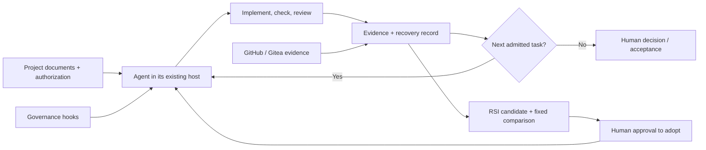

# SAGE-Kit

[English](README.md) | [中文](README.zh-CN.md)

[](https://github.com/JoeKeepGo/SAGE-Kit/actions/workflows/sagekit-self-check.yml)
[](LICENSE)

SAGE-Kit helps AI agents develop from project documents across tasks and sessions.
The project owner sets the objective, scope, budget and acceptance conditions;
agents implement, check, review and continue within that authorization. Hooks
refresh governance context, while controlled RSI evaluates improvements to the
development method before a human decides whether to adopt them.

**Current main is a rebuild preview.** It preserves the governance core from
**v2026.8.13.1** and adds optional execution support. A first real-model Codex trial
completed three document-defined tasks and resumed at a completed-task boundary.
It also exposed a tool-hook coverage gap: long-term semi-autonomous reliability
has not been accepted. See [verification and limits](#verification-and-limits).

## How it fits together

- **Governance:** the portable [SAGE-Kit Skill](skills/sage-kit) and project
  instructions preserve SPEC authority, risk-based review, evidence ownership
  and human acceptance. This layer works without an additional runtime.
- **Execution support:** the optional [host adapters](adapters/README.md) connect
  DSH, Codex and Claude Code to bounded plans, local recovery records and hooks.
  The existing agent host runs the model and tools.
- **Controlled RSI:** failure and review evidence can lead to an isolated candidate,
  a fixed baseline comparison, human approval, adoption and rollback. RSI cannot
  grant permission or rewrite its evaluation criteria.
- **Platform evidence:** explicit GitHub/Gitea tools capture Issue feedback and
  Actions run/job results. A successful run proves only its recorded scope;
  platform content never grants permission or product acceptance.



There is no SAGE-Kit task CLI, polling daemon or separate model executor. DSH
uses its existing plugin host; Codex/Claude use a connection-owned MCP process.
Checks have bounded reads and outputs, unchanged read-only checks do not rewrite
state, and RSI evaluation has a separate budget. See the
[continuation](docs/rebuild/continuation.md) and [RSI](docs/rebuild/rsi.md) protocols.

## Start with a project

1. **Select the project's authority.** Point to its current SPEC, acceptance
   criteria and decisions. Existing document structures and requirement IDs can
   be retained; use the [mapping guide](docs/rebuild/project-mapping.md).
2. **Install governance.** Install the entire [`skills/sage-kit`](skills/sage-kit)
   directory through the host's Skill mechanism and adapt the
   [`AGENTS.md` bootstrap](docs/templates/AGENTS_SAGE_BOOTSTRAP_TEMPLATE.md).
   Follow the packaged host reference for other instruction entry points.
   Update the Skill as a complete directory, not a mixture of release files.
3. **Choose an authorized round.** Specify admitted tasks, allowed paths and
   operations, checks, budget, expiry, recovery rules and human gates. A document
   describing a command is not authorization to execute it.
4. **Add execution support if needed.** Start with the
   [minimal local example](examples/rebuild/minimal/README.md), then configure
   [DSH or Codex/Claude MCP and hooks](adapters/README.md) in an isolated profile.
   Match actual host tool names and verify refusal before admission; the current
   hook coverage limitation still applies.

The optional adapter requires Node.js 22+ and is currently a **private local
package**, named `@sage-kit/dsh-plugin` for historical compatibility. From this
source checkout, package it without lifecycle scripts:

```sh
mkdir -p local/packages
npm pack ./adapters --ignore-scripts --pack-destination local/packages
```

Follow the [adapter installation instructions](adapters/README.md) for the selected
host. The package does not include the Skill, example project or tests. Its name
does not imply a published npm installation path. Historical releases may describe
an earlier architecture; this README describes the current `main` source.

## Governance that stays in place

The project's current SPEC owns intent and acceptance criteria. Git, runtime
observations, checks and artifacts own the facts they expose. State files and
Issue content do not replace either authority. Revalidate evidence when its
relevant inputs change; reuse unaffected evidence.

Light work uses the small project kernel. Standard/Heavy work and semantic
review load the full Skill; permission remains separate from risk level. Project
instructions route normal work, with explicit `$sage-kit` available for overrides
or routing diagnosis. Use only the planning templates the task needs, and stop
at human gates. Details: [governance core](docs/SAGE_CORE.md),
[levels](docs/agent/GOVERNANCE_LEVELS.md), and
[evidence rules](docs/agent/CLAIM_EVIDENCE_TRUST.md).

## Verification and limits

These are recorded test versions and scopes, not a promise about every host version.

| Surface | Evidence available | Remaining boundary |
|---|---|---|
| DSH 0.2.1-rc.2 | Native plugin/profile, installed package, tools, interruption and RSI protocol checks with deterministic model responses | Real-model long-task quality and human strategy adoption remain unverified |
| Codex CLI 0.163.0-alpha.11.2 | Native regression checks and a real `gpt-6.1-sol` trial: version fix, package verification, minimal example, same-session boundary resume and human-gate stop | The trial needed two startup corrections and one controller rescue; natural real-model compaction and complete hook coverage remain unverified |
| Claude Code 2.1.310 | Native process, MCP tools and hooks with deterministic model responses | No real-model development trial or native compaction/resume acceptance |
| GitHub / Gitea | Actual Issue and successful/failed Actions observations; source/run/job bindings | No general claim about deployment state, PR review or artifact contents |
| OpenCode / Kimi | Packaged governance guidance | No execution-adapter validation in this rebuild |

**Known hook gap:** a real Codex command ran before a fresh `begin`. The tested
guarded-tool list was incomplete, and code-mode wrapping/nested tool events were
not resolved from the captured logs. Hooks therefore cannot yet be described as
covering every command or providing OS isolation. Resource samples apply only to
that tested configuration, not to fully covered governance under sustained load.

The [main integration CI](https://github.com/JoeKeepGo/SAGE-Kit/actions/runs/40214668141)
passed all five jobs at `093a137`: continuation/RSI, DSH, and static/package
reference checks on Linux, Windows and macOS. This does not establish native
agent support on all three operating systems. See the [progress record](docs/rebuild/progress.md)
for exact checks, failures, interventions and remaining acceptance work.
Nothing continues after a host stops unless a separate scheduling mechanism is
explicitly authorized and running.

## Repository contents

| Path | Purpose |
|---|---|
| [`skills/sage-kit/`](skills/sage-kit) | Installable governance Skill, host guidance and required portable references |
| [`docs/agent/`](docs/agent), [`docs/templates/`](docs/templates), [`docs/profiles/`](docs/profiles) | Governance source and optional planning templates/profiles |
| [`contracts/`](contracts) | Static contracts and compatibility schemas; their presence does not execute work |
| [`adapters/`](adapters) | Optional continuation, hooks, RSI and platform-evidence implementation |
| [`examples/rebuild/`](examples/rebuild) | Minimal adoption walkthrough and bounded document-mapping example |
| [`tests/`](tests), [`scripts/`](scripts), [CI](.github/workflows/sagekit-self-check.yml) | Regression checks, native-host fixtures and package integrity |
| [`docs/rebuild/`](docs/rebuild), [decisions](docs/decisions.md) | Rebuild specification, protocols, acceptance criteria and evidence summaries |

The Skill's `references/framework/` copies are intentional: its manifest binds
them so the installed Skill works without this repository. Local raw logs,
session state, installed dependencies and test artifacts belong under ignored
paths such as `local/`; they are not shipped. Earlier runtime code remains in Git
history, while the current tree contains the rebuilt implementation.
