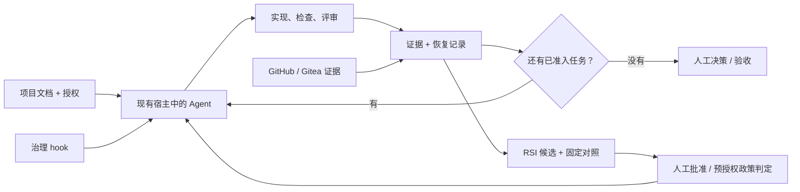

# SAGE-Kit

[English](README.md) | [中文](README.zh-CN.md)

[](https://github.com/JoeKeepGo/SAGE-Kit/actions/workflows/sagekit-self-check.yml)
[](LICENSE)

SAGE-Kit 帮助 AI Agent 依据项目文档从零建立项目，或在已有项目上跨任务、跨会话持续开发。项目负责人确定
目标、范围、预算与验收条件，Agent 在授权内实现、检查、评审并继续下一项工作。
Hook 在关键节点带回治理上下文；RSI 评估开发方法的改进，支持逐次人工批准或
项目开发分支内的预授权自动采用与回滚。

**当前源码是重建预览版。** 保留 **v2026.8.13.1** 治理核心，并增加可选执行支持。
首轮真实 Codex 模型已完成文档规定的三项任务，并在已完成任务的边界重启续接。
该轮也发现工具 hook 覆盖缺口，长期半自主可靠性仍未验收，详见[验证与限制](#验证与限制)。
R7 另由真实模型从空实现 docset 开发了任务依赖分析库、CLI、测试和文档，独立复跑
固定验收及 54 项产品测试通过。试验中修正过一次完成工具的结构说明，再续接完成；
这证明小项目路径可行，不是大型项目无人干预开发的保证。

## 各部分如何协作

- **治理层**：[SAGE-Kit Skill](skills/sage-kit) 与项目指令保留 SPEC 权威、按风险评审、
  证据归属和人工验收。这一层无需安装额外运行时。
- **执行支持**：可选[宿主适配器](adapters/README.md)把 DSH、Codex、Claude Code
  接到有界计划、本地恢复记录和 hook；模型与工具仍由现有 Agent 宿主运行。
- **RSI**：默认经固定评估、基线对照和人工批准后采用；也可预先批准具体开发分支、
  目标、判据与预算，在其中自动采用、复验及回滚。没有改进不采用，两轮连续失败
  停止。RSI 不能自行授权、修改验收或合并主线，最终产品验收仍由人决定。
- **平台证据**：显式调用 GitHub/Gitea 工具，读取 Issue 反馈与 Actions 运行及 job
  结果。流水线成功只证明记录的检查范围，平台内容不授予权限或产品验收。



没有另建任务 CLI、轮询守护进程或模型执行器。DSH 使用现有插件宿主，Codex/Claude
由宿主连接持有 MCP 进程。检查限制读取量与输出量，未变化的只读检查不重写状态，
RSI 评估使用独立预算。详见[持续执行](docs/rebuild/continuation.md)与
[RSI](docs/rebuild/rsi.md)协议。

## 从一个项目开始

1. **选定项目权威。** 指向当前 SPEC、验收条件与决策。可以沿用现有文档结构及需求
   ID，不必搬入统一模板；参考[规范映射](docs/rebuild/project-mapping.md)。
2. **安装治理。** 通过宿主的 Skill 机制安装完整的
   [`skills/sage-kit`](skills/sage-kit) 目录，使用
   [`AGENTS.md` 入口模板](docs/templates/AGENTS_SAGE_BOOTSTRAP_TEMPLATE.md)。
   其它宿主的指令入口参照包内说明。更新时整体替换 Skill，不混用不同版本的文件。
3. **确定一轮授权。** 列明已准入任务、允许路径与操作、检查、预算、到期时间、
   恢复规则和人工关口。文档写了某条命令，不等于已经授权执行它。
4. **按需接入执行支持。** 只有文档的新项目可用[从零开发流程](docs/rebuild/from-docset.md)
   和[空实现样例](examples/rebuild/from-docset/README.md)；简单接线可用
   [最小本地示例](examples/rebuild/minimal/README.md)。
   在隔离配置中连接 [DSH 或 Codex/Claude 的 MCP 与 hook](adapters/README.md)。
   按实际宿主工具名配置，并验证未准入操作能被拒绝；当前 hook 覆盖限制仍然适用。

可选适配器需要 Node.js 22+，目前是**私有本地包**，为兼容保留名称
`@sage-kit/dsh-plugin`。在本源码仓库中执行以下命令打包，不运行生命周期脚本：

```sh
mkdir -p local/packages
npm pack ./adapters --ignore-scripts --pack-destination local/packages
```

随后按[适配器安装说明](adapters/README.md)配置所选宿主。适配器包不包含治理 Skill、
示例项目或测试；包名不意味着已有可直接安装的 npm 发布版。历史 release 可能对应
较早架构，本页描述当前源码；尚未发布到 npm。

## 保留的治理能力

当前项目 SPEC 拥有目标和验收标准；Git、运行观察、检查和工件拥有各自能证明的事实。
状态文件与 Issue 内容不能替代这些权威。相关输入变化时重验受影响证据，未受影响
的证据可以复用。

Light 工作使用轻量项目入口；Standard/Heavy 与实质语义评审加载完整 Skill，
风险等级与权限分别判断。日常由项目指令路由，显式 `$sage-kit` 用于覆盖或诊断路由。
按任务需要选择规划模板，在人工关口停止。详见[治理核心](docs/SAGE_CORE.md)、
[治理等级](docs/agent/GOVERNANCE_LEVELS.md)与[证据规则](docs/agent/CLAIM_EVIDENCE_TRUST.md)。

## 验证与限制

以下是已记录的测试版本和范围，不代表所有宿主版本均有相同行为。

| 入口 | 已有证据 | 尚未证明的部分 |
|---|---|---|
| DSH 0.2.1-rc.2 | 原生插件/profile、安装包、工具、中断及 RSI 协议检查，模型回答为确定性替身 | 真实模型长任务质量与真人策略采用 |
| Codex CLI 0.163.0-alpha.11.2 | 原生回归，以及真实 `gpt-6.1-sol` 完成版本修复、安装包验证、最小示例；同会话边界续接并停在人工关口 | 本轮有两次启动修正、一次控制者救援；真实模型自然压缩和完整 hook 覆盖仍未验证 |
| Claude Code 2.1.310 | 原生进程、MCP 工具和 hook，模型回答为确定性替身 | 真实模型开发试运行、原生压缩与恢复验收 |
| GitHub / Gitea | 实际 Issue 以及成功/失败 Actions 观察，绑定来源、运行和 jobs | 不推导部署状态、PR 评审或工件内容 |
| OpenCode / Kimi | 包内治理接入指引 | 本轮没有执行适配器验证 |

**已知 hook 缺口：** 真实 Codex 试运行中，一条命令在新的 `begin` 前执行成功。
受检查工具列表不完整，code-mode 包装与嵌套工具事件也未能从原始记录确定。
因此不能宣称所有命令都经过治理门禁，也不能把 hook 当作操作系统隔离。
资源采样只代表该轮配置，不能推导完整治理覆盖下的长期 CPU/IO 表现。

[主线整合 CI](https://github.com/JoeKeepGo/SAGE-Kit/actions/runs/40214668141) 在
`093a137` 上的五个 job 全部通过：持续执行/RSI、DSH，以及 Linux、Windows、macOS
的静态与包引用检查。这不代表三种系统上的原生 Agent 均已验收。具体检查、失败、
干预和剩余验收见[进度记录](docs/rebuild/progress.md)。宿主停止后不会自行继续工作，
除非另有已授权并运行中的调度机制。

## 仓库内容

| 路径 | 用途 |
|---|---|
| [`skills/sage-kit/`](skills/sage-kit) | 可安装的治理 Skill、宿主指引与必需便携引用 |
| [`docs/agent/`](docs/agent)、[`docs/templates/`](docs/templates)、[`docs/profiles/`](docs/profiles) | 治理原文与可选规划模板/专项配置 |
| [`contracts/`](contracts) | 静态契约与兼容 schema；文件存在不代表执行了工作 |
| [`adapters/`](adapters) | 可选持续执行、hook、RSI 与平台证据实现 |
| [`examples/rebuild/`](examples/rebuild) | 从文档启动空项目、最小接入示例与有界文档映射案例 |
| [`tests/`](tests)、[`scripts/`](scripts)、[CI](.github/workflows/sagekit-self-check.yml) | 回归检查、原生宿主夹具和包完整性 |
| [`docs/rebuild/`](docs/rebuild)、[决策](docs/decisions.md) | 重建规范、协议、验收条件与证据摘要 |

Skill 内的 `references/framework/` 副本用于独立安装，由 manifest 绑定，保证离开
本仓库仍能读取必需治理规则。本地原始日志、会话状态、安装依赖与测试工件应放在
`local/` 等忽略路径，不随源码交付。此前运行时实现保留在 Git 历史中，当前目录树
使用重建后的实现。
