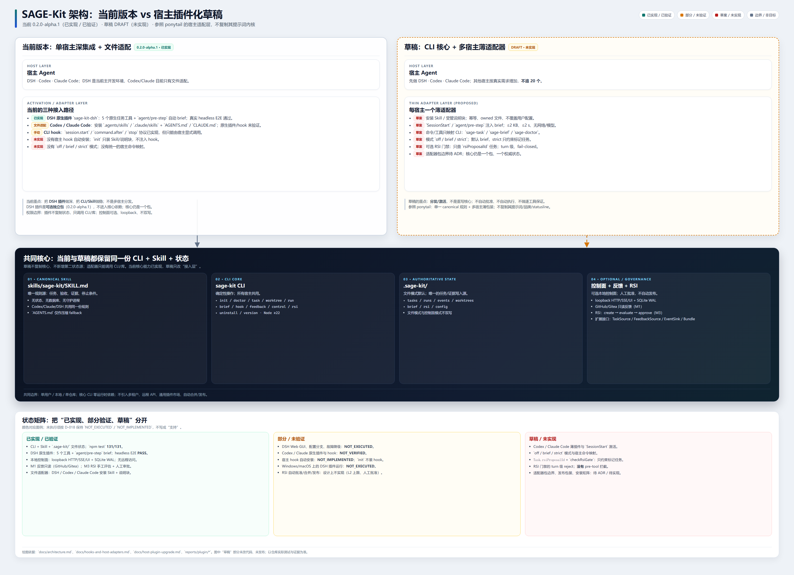

# 宿主插件化升级方案（参照 ponytail 的分发层）

**状态（2026-10-25）：核心部分已实现（DSH 插件 `off/brief/strict` + 只读 RSI 门禁、Codex/Claude 宿主包、`Task.rsiProposalId`、`checkRsiGate`、quickstart）；真实宿主激活矩阵仍有未执行项，未验证路径继续标 `NOT_EXECUTED`。本文不是架构基线，冲突时以 `docs/decisions.md` / `docs/architecture.md` 为准。**
本文回答一个问题：SAGE-Kit 是否应该、以及怎样从“单宿主 Skill / DSH 插件”升级为多宿主薄插件。结论是**借鉴 ponytail 的宿主适配和分发方式，不借鉴它的提示词内核**。



---

## 1. 结论

采用下面这个形态，而不是把 SAGE-Kit 重写成第二个 ponytail：

```text
CLI 核心（唯一状态写入源）
  + 一份 canonical Skill（唯一规则源）
  + 每宿主一个薄适配器（安装、激活、命令/工具）
```

具体建议：

1. **保留 CLI 和 `.sage-kit/` 文件状态为权威源**，宿主适配器不复制状态、不直接改任务文件。
2. **保留 `skills/sage-kit/SKILL.md` 为唯一规则源**，不为每个宿主维护不同版本的行为说明。
3. **先做 DSH → Codex → Claude Code 三个宿主**；其他宿主不追求 20 个的覆盖面，按真实需求增加。
4. **增加 `off / brief / strict` 三种模式**，默认只在已初始化项目注入 brief；strict 只约束显式标记的任务。
5. **RSI 门禁仍单独设计**：只有带 `rsiProposalId` 的任务才受约束；不自动批准、不自动执行、不做逐工具硬保证。
6. **每个宿主必须有真实安装/激活/卸载证据**；未跑过的路径继续标 `NOT_EXECUTED`。

---

## 2. 当前状态与真实缺口

| 层 | 当前实现 | 缺口 |
|---|---|---|
| 核心 CLI | `0.2.0-alpha.1`；init/doctor/task/run/brief/hook/feedback/control/rsi/uninstall | 已有，不是本次升级重点 |
| Skill | `skills/sage-kit/SKILL.md`；Codex/Claude/DSH 文件适配器可安装 | 规则只有一份，但没有宿主级模式/命令 |
| DSH 插件 | `packages/dsh-plugin`；5 个原生工具 + `agent/pre-step` brief + `off/brief/strict` + 只读 RSI 门禁 | headless E2E 已通过；Web GUI、配置分支、故障降级未执行 |
| Codex | 文件适配器安装 `.agents/skills` + `AGENTS.md`；可选宿主包 `host install --host codex`（marketplace + 薄插件 + session-start bridge） | 真实 Codex 会话 hook 信任/激活未执行；只在隔离 `CODEX_HOME` 验证注册往返 |
| Claude Code | 文件适配器安装 `.claude/skills` + `CLAUDE.md`；可选宿主包 `host install --host claude` | 真实 Claude Code 安装/激活未执行 |
| Hook 安装 | `sage-kit hook` 可被宿主显式调用；host bridge 在已初始化项目注入 brief | `init` 不自动安装任何宿主 hook；DSH 的 `pre-step` 是插件路径，不是 CLI hook |
| 模式/命令 | DSH 有 `off/brief/strict` 与原生工具；Codex/Claude 通过宿主包 bridge/Skill 指令 | 其他宿主没有统一模式开关；未验证的宿主激活矩阵仍缺 |
| 测试 | 本次 Windows 可写修复副本 206 项：205 通过、0 失败、1 跳过 | 本次未重跑 WSL2/真实多宿主激活矩阵 |

**核心结论：缺的不是任务/证据/RSI 能力，而是分发、激活、安装/卸载和每宿主验收。**

---

## 3. ponytail 实际是什么

参考仓库：[DietrichGebert/ponytail](https://github.com/DietrichGebert/ponytail)（MIT，检查时版本 `5.3.2`，HEAD `09c434ab73ca43761c5d8b0c5d341926c2fba710`）。

它的结构可以概括为：

- **一个行为提示词**：`skills/ponytail/SKILL.md`，另有压缩版 `AGENTS.md`。
- **一组宿主适配器**：`.claude-plugin/`、`.codex-plugin/`、`plugin.yaml`、`.opencode/`、Cursor/Windsurf/Copilot 等规则文件。
- **生命周期 hook**：例如 Claude/Codex 的 `SessionStart` 注入规则，Hermes 的 `pre_llm_call` / `pre_gateway_dispatch`。
- **命令和模式**：`/ponytail lite|full|ultra|off`、review/audit/debt/gain/help 等命令；模式状态由 hook/配置维护。
- **可选呈现层**：Claude Code statusline、band、本地 board；不影响核心规则。
- **安装/卸载和测试**：`INSTALL.md`、安装脚本、Node 测试。

关键事实：**ponytail 的核心仍是提示词，插件/hook 只是把同一份提示词送到不同宿主。** 它不是任务状态系统，也不提供证据门禁或 RSI 评估。

### 3.1 与 SAGE-Kit 的相同点

- 都希望“一份权威规则，多宿主加载”。
- 都需要处理宿主差异、安装路径、会话开始注入、失败降级。
- 都适合 MIT/本地优先、无服务端的形态。

### 3.2 关键不同

| 维度 | ponytail | SAGE-Kit |
|---|---|---|
| 核心 | 行为风格提示词 | CLI + 文件状态 + 任务/证据/RSI |
| 状态 | 基本无状态（模式 flag 除外） | `.sage-kit/` 是权威状态 |
| 失败策略 | hook 默认 fail-open | 普通 hook fail-open；**RSI 标记任务的门禁需要 fail-closed** |
| 目标 | 更少代码、更短方案 | 可追踪任务、可审计证据、受控自我改进 |
| 适配面 | 20 个左右宿主 | 先做 DSH/Codex/Claude 三个 |

因此，**可以借鉴 ponytail 的分发层，不能把它的“单一提示词内核”当成 SAGE-Kit 的升级方向。**

---

## 4. 目标形态

```text
┌──────────────────────────────────────────────────────────────┐
│ 宿主：DSH / Codex / Claude Code / （以后按需）               │
│  └─ 薄适配器                                                 │
│     ├─ 安装 Skill / 受管说明块                               │
│     ├─ SessionStart 或 pre-step 注入 brief                   │
│     ├─ 可选命令/工具（只映射 CLI）                           │
│     └─ 可选 RSI 门禁（只检查标记任务）                       │
└──────────────────────────┬───────────────────────────────────┘
                           │ 只调用 CLI/库，不直接写状态
                           ▼
┌──────────────────────────────────────────────────────────────┐
│ 一份 canonical Skill：SKILL.md + references + templates      │
│ 无状态；不持有数据库、不启动守护进程、不隐藏网络调用          │
└──────────────────────────┬───────────────────────────────────┘
                           │
                           ▼
┌──────────────────────────────────────────────────────────────┐
│ sage-kit CLI / library（权威状态）                            │
│ .sage-kit/：tasks / runs / events / brief / rsi               │
│ 文件模式默认；控制面可选；不双写                              │
└──────────────────────────────────────────────────────────────┘
```

### 4.1 核心不变量

1. **单一写入源**：文件模式或控制面模式二选一；适配器绝不直接写任务/事件/RSI 文件。
2. **单一规则源**：所有宿主加载同一份 `SKILL.md`；宿主差异只允许出现在适配器的安装/激活代码里。
3. **确定性操作归 CLI**：任务状态转换、brief 生成、证据校验、RSI 查询都在核心；适配器只做参数转发和展示。
4. **不增加常驻进程**：适配器不启动 daemon、不轮询、不建立自己的队列。
5. **不可信文本不执行**：反馈/Issue/PR 文本只作为数据，不进入指令位置。

### 4.2 适配器契约

每个宿主适配器必须满足：

| 契约 | 要求 |
|---|---|
| 安装 | 安装 Skill/说明块；幂等；记录 owned 文件；不覆盖用户已有配置 |
| 卸载 | 只删除自己创建的内容；用户文件保留；重复卸载安全 |
| 激活 | 会话开始/下一步前注入 brief；项目未初始化时 no-op |
| 预算 | 单次注入 ≤ 2 KB（可由配置放宽到 8 KB）；超时 ≤ 2 s；无网络、无模型调用 |
| 状态 | 只调用 CLI 或 `src/index.ts` 导出的库 API；不复制状态 |
| 失败 | 普通注入 fail-open；RSI 门禁对标记任务 fail-closed |
| 版本 | 声明宿主版本范围；不匹配时拒绝安装/明确提示，不静默降级 |
| 可观测 | 失败写宿主日志/`logger.warn`；不把失败伪装成成功 |
| 证据 | 每个宿主单独记录安装、激活、卸载、故障路径的证据；未跑过标 `NOT_EXECUTED` |

### 4.3 模式

建议引入三种模式，而不是 ponytail 的 `lite/full/ultra`：

| 模式 | 行为 |
|---|---|
| `off` | 不注入、不检查；Skill 仍可手动使用 |
| `brief` | 注入当前任务 brief；默认 |
| `strict` | 注入 brief + 对带 `rsiProposalId` 的任务执行门禁 |

规则：

- 只在存在 `.sage-kit/config.json` 的项目生效；普通项目 no-op。
- 默认 `brief`；`strict` 必须由用户显式开启（项目配置或宿主配置）。
- 模式切换只写一个小配置/flag；不引入后台进程。
- 模式不是安全边界；真正的边界仍是任务标记和门禁。

### 4.4 RSI 门禁（与宿主插件化的关系）

当前 RSI 是手动流程：`rsi create` → `run-once` → `request-approval` → `approve`。`approve` 只记录批准，不自动应用补丁。

建议的最小门禁：

1. `Task` 增加可选 `rsiProposalId`；只有带该字段的任务才是“RSI 标记任务”。
2. `checkRsiGate(projectRoot, proposalId)` 校验：
   - 提案存在；
   - `status === "approved"`；
   - `evaluationId` 对应评估 `outcome === "passed"`；
   - `approvalId` 对应审批 `decision === "approved"`。
3. 宿主适配器在 `pre-step`/`SessionStart` 读取活动任务；有标记且门禁失败时 `reject`，无标记时放行。
4. 提案创建/评估任务本身不加标记；只有“实现已批准提案”的任务加标记。
5. 不做静默自动开启：模型可以建议“是否进入 RSI”，用户确认后才标记。

**限制必须写明：**

- 这是 **turn 级**门禁，不是逐工具拦截；DSH 0.2.1-rc.2 当前只有 `agent/pre-step` 可拦 turn，没有 pre-tool 拦截点。
- 它不是“自动辨识 RSI”；识别仍靠模型判断 + 用户确认，可能漏判/误判。
- 它不自动批准、不自动执行、不自动发布。
- 它不覆盖未标记的普通任务；用户选择“不开启”时仍可走普通流程。

### 4.5 宿主矩阵

| 宿主 | 当前 | 目标 | 证据要求 |
|---|---|---|---|
| DSH | 可选原生插件；工具 + `agent/pre-step` brief；headless E2E 通过 | 加模式/RSI 门禁；补 Web GUI/配置分支 | 真实 DSH 0.2.1-rc.2 headless；GUI 单列 `NOT_EXECUTED` |
| Codex | 文件适配器；Skill/说明块 | 插件 manifest + SessionStart/可用 hook + 命令 | 真实 Codex 会话；未跑过不写“支持” |
| Claude Code | 文件适配器；Skill/说明块 | 插件 manifest + SessionStart + 命令 | 真实 Claude Code 会话 |
| Cursor / OpenCode / 其他 | 未实现 | 暂不承诺 | 有真实需求 + 宿主 API 核对后再做 |

**不追求 20 个宿主。** ponytail 的覆盖面是它的产品选择；SAGE-Kit 的维护能力有限，先保证三个宿主可验证。

### 4.6 包与发布边界

- 核心仍是**一个仓库、一个核心 npm 包**（D-002）。
- 宿主适配器是否各自成为独立包，需要新 ADR；当前只有 DSH 插件是独立可选包（D-023）。
- 不引入通用插件市场/注册发现/事件总线（D-015 不变）；这里只做明确列出的宿主适配。
- 适配器不进入核心依赖；不安装适配器时，CLI + Skill 仍可工作。
- 发布前必须有打包、安装、卸载、版本不匹配、失败降级证据；否则保持内部 alpha。

---

## 5. 借鉴 / 不借鉴

### 5.1 借鉴

- 一份 canonical 规则 + 每宿主薄包装。
- `SessionStart`/pre-step 注入，而不是让用户每轮手动读文件。
- 模式切换（`off/brief/strict`）。
- 命令/工具只做 CLI 的薄映射。
- 安装/卸载脚本、幂等、owned 文件、用户配置保护。
- 多宿主安装矩阵和失败降级测试。
- `AGENTS.md` 作为压缩 fallback（当 Skill 不可加载时）。

### 5.2 不借鉴

- 不把核心改成单一提示词。
- 不一次支持 20 个宿主。
- 不复制 ponytail 的提示词、品牌、statusline、band、webhook/遥测。
- 不把“自动激活”当成“强制执行”；RSI 必须用户确认。
- 不对标记任务使用 fail-open；门禁失败必须拒绝。
- 不为适配器新增状态库/队列/控制面。
- 不在没有真实宿主证据时写“支持”。

---

## 6. 分阶段计划

### Phase 0：文档与决策（当前）

- 本文评审。
- 需要时新增 ADR：适配器包边界、默认模式、RSI 门禁 fail-closed 例外。
- 不修改代码；不发布。

**退出条件：** 明确接受/拒绝本文；未决问题有结论或保持未决。

### Phase 1：DSH 收口 + RSI 门禁

- 增加 `Task.rsiProposalId`（可选，schema 仍为 1）。
- 新增 `src/rsi/gate.ts`；`checkRsiGate()` 只读。
- DSH 插件 `agent/pre-step` 增加标记任务门禁；未标记任务不变。
- 测试：未标记放行、未找到提案拒绝、未批准拒绝、评估失败拒绝、批准通过、普通任务不受影响。
- 文档：`hooks-and-host-adapters.md`、DSH 插件 README、`feedback-and-rsi.md`、`CHANGELOG.md`。

**退出条件：** 单测 + DSH headless E2E 通过；Web GUI 等未跑路径标 `NOT_EXECUTED`。

### Phase 2：Codex 适配器

- 先核对 Codex 当前插件/hook 公开格式；不凭猜测写 manifest。
- 实现 Skill + 说明块 + 可用生命周期 hook + 可选命令。
- 安装/卸载幂等；brief 超时/失败降级。
- 真实 Codex 会话验收；未通过前不写“已支持”。

**退出条件：** 安装、激活、卸载、失败路径各有证据。

### Phase 3：Claude Code 适配器

- 同上；使用 Claude Code 官方插件/hook 格式。
- 不复制 ponytail 的 statusline/band；最多做可选任务状态提示（另议）。

**退出条件：** 同上。

#### Phase 2/3 草案进展（未提交工作树，2026-10-25）

- 文件级薄插件模板：`packages/host-codex/`（`.codex-plugin/plugin.json`、`hooks/hooks.json`、`hooks/session-start.cjs`）与 `packages/host-claude/`（`.claude-plugin/plugin.json`、同一 hook 桥与 hook 配置）；Skill 不在模板内，安装时从规范 `skills/sage-kit` 复制，避免第二份手写 Skill。
- 适配器新增并已接入 CLI：`sage-kit host install|uninstall --host codex|claude`；`installCodexHostBundle` / `uninstallCodexHostBundle`、`installClaudeHostBundle` / `uninstallClaudeHostBundle` 把“marketplace + 插件 + Skill 副本”暂存到 `.sage-kit/hosts/<host>/`，并写归属标记；重复安装幂等，卸载只删自有文件，无标记目录默认拒绝覆盖。宿主注册仍由宿主 CLI 完成，SAGE-Kit 不改 `~/.codex`、`~/.claude` 配置。
- 归属标记保持 schemaVersion 1：`files` 只记录成功写入的文件，可选 `pendingFiles` 记录尚未完成的目标；重试不会把未创建目标上的用户文件当成自有文件，卸载也不删除它。单个文件写入成功但标记更新失败时，该文件可能仍是 pending；重试会明确拒绝现有未归属文件，需人工检查后移走或显式 `--force`。核心卸载删除配置后，仍可用 `host uninstall --project-root <项目>` 根据归属标记清理暂存。
- 普通 `init` 遇到保留的 Skill 目录缺少 `SKILL.md` 时返回 `E_SKILL_INCOMPLETE`，不覆盖用户内容、不重新写入配置；先移走保留目录，再执行初始化。
- `SessionStart` 桥只读：只调用 `sage-kit brief --json --require-initialized`，stdin 只取 `cwd`；根目录解析交给核心库（支持已初始化的 linked worktree），未初始化/无法解析时 no-op；超时（默认 2 s）或坏输出降级为 `{}`；注入文本按 UTF-8 字节上限（默认 2 KB）截断。
- 已验证：本机 Codex CLI 0.164.0，隔离 `CODEX_HOME` 下 `plugin marketplace add` → `plugin add sage-kit@sage-kit` → `plugin list` → `plugin remove` 往返成功，真实 `~/.codex/config.toml` 未被修改；暂存/重复暂存/卸载幂等、Skill 逐字节一致、桥的 no-op/超时/截断由 `tests/host-adapters.test.mjs` 覆盖。
- `NOT_EXECUTED`：真实 Codex 会话 `/hooks` 信任与注入激活；真实 Claude Code 安装/激活（本机无 CLI）；`packages/host-*` 在 npm 安装包中的真实 staging（已加入根 `files`，但未做 tarball 端到端；仓库内 staging 已验证）。

### Phase 4：模式、命令、打包

- `off/brief/strict` 配置与文档（DSH 插件已实现；Codex/Claude 桥只做 brief）。
- 命令映射（`/sage-task`、`/sage-brief`、`/sage-doctor`）或宿主等价工具；当前仍以 Skill/CLI 调用为主，未做宿主斜杠命令注册。
- 打包、安装矩阵、版本兼容、卸载测试：`sage-kit host install|uninstall` 与根 `files` 已接入；三宿主真实激活矩阵仍未完成。
- 决定是否发布到 npm/插件市场；未决定前保持内部 alpha。

**退出条件：** 三宿主矩阵通过；发布检查清单完成。

### Phase 5：其他宿主（按需）

- 只有真实用户需求 + 宿主 API 可验证时才做。
- 不承诺数量；不为“覆盖广”牺牲可维护性。

---

## 7. 验收标准

一个宿主适配器只有满足以下条件才算“可用”：

1. 在干净项目上安装成功；重复安装幂等。
2. 卸载只删除自己创建的内容；用户已有 Skill/说明块/配置不被破坏。
3. 已初始化项目注入 brief；未初始化项目 no-op。
4. brief ≤ 2 KB（或配置上限）；单次 ≤ 2 s；无网络/模型调用。
5. 任务状态转换仍由 CLI/核心库完成；适配器没有第二份状态。
6. 普通 hook 失败不阻断；RSI 标记任务门禁失败必须拒绝。
7. `strict` 模式下未批准的标记任务不能进入下一步；`brief`/`off` 行为明确。
8. 宿主版本不匹配时拒绝或明确提示，不静默运行。
9. Windows/Linux 至少一个真实环境通过；主测试环境仍按 `docs/platform-support.md`。
10. 未执行路径全部标 `NOT_EXECUTED`；文档不把设计写成已实现（D-018）。

---

## 8. 风险与取舍

| 风险 | 影响 | 缓解 |
|---|---|---|
| 多宿主 API 漂移 | 适配器频繁损坏 | 只做三个；版本范围；真实宿主测试；失败明确 |
| 适配器变成第二状态源 | 双写/不一致 | 只调用 CLI/库；代码审查禁止直接写 `.sage-kit` |
| hook 自动安装破坏用户配置 | 用户不信任 | 显式安装；owned 文件；幂等；不覆盖 |
| RSI 门禁误判 | 阻塞正常工作 | 只对显式标记任务；用户确认；可 `off` |
| “自动辨识 RSI”不可靠 | 漏判/误判 | 模型建议 + 用户确认；不做静默自动开启 |
| 逐工具保证无法实现 | 错误安全感 | 文档写明 turn 级；不承诺 pre-tool |
| 复制 ponytail 代码/提示词 | 许可证/品牌/维护问题 | 只借鉴模式；复用代码需记录来源/commit/MIT 归属 |
| 范围膨胀到 20 宿主 | 维护崩溃 | 明确非目标；按需求增加 |

---

## 9. 未决问题

以下问题不在本文冻结，实施前需要单独决定：

1. 默认模式是 `brief` 还是 `off`？是否按项目配置覆盖？
2. 宿主适配器是否各自成为 npm 包，还是同一仓库的 `packages/host-*` 目录？需要新 ADR 处理 D-002/D-023。
3. 是否发布到 npm/插件市场；包名/scope 是什么？
4. Codex/Claude 的 hook 是否可自动安装，还是只提供安装脚本？必须以宿主公开文档为准。
5. RSI 标记任务的用户确认方式：对话确认、CLI 命令，还是两者都支持？
6. `strict` 是否默认关闭？是否允许项目级开启？
7. 是否提供可选状态栏/任务提示；本文建议暂不做。

---

## 10. 参考

- [DietrichGebert/ponytail](https://github.com/DietrichGebert/ponytail)，MIT，检查时版本 `5.3.2`，HEAD `09c434ab73ca43761c5d8b0c5d341926c2fba710`。
- `docs/architecture.md`：分层、状态归属、非目标。
- `docs/hooks-and-host-adapters.md`：CLI hook 协议、DSH 插件边界、失败降级。
- `docs/decisions.md`：D-002、D-013、D-015、D-016、D-018、D-021、D-023。
- `docs/skill-contract.md`：Skill 触发、工作流、停止条件。
- `docs/platform-support.md`：Windows/Linux/WSL 测试边界。
- `packages/dsh-plugin/README.md`：DSH 插件安装、配置、限制和验证状态。
