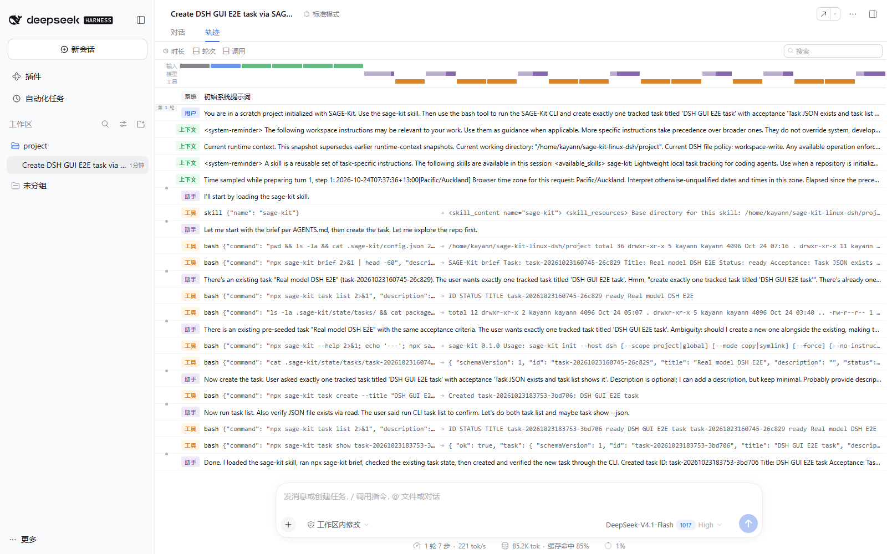
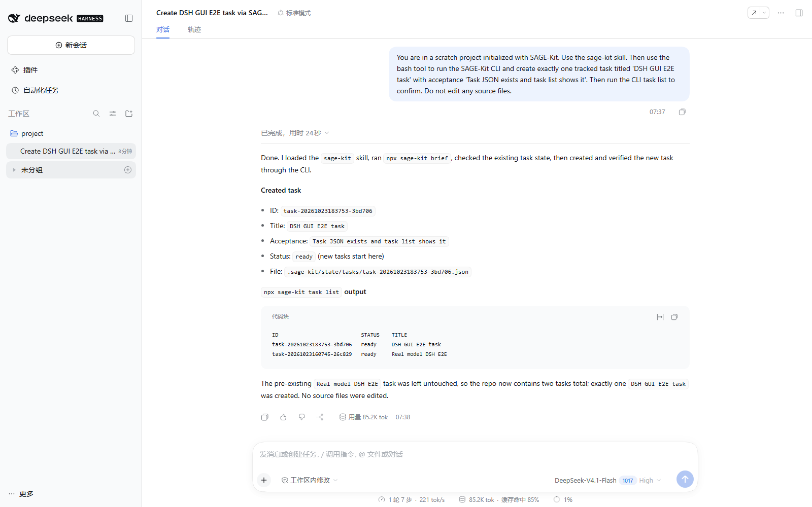

# P0-A13：DSH Web GUI E2E（真实模型 + 停止/重启生命周期 + hook 边界）

日期：2026-10-24（Pacific/Auckland；主要操作 UTC 2026-10-23 18:37–18:58）
执行：teammate `dsh-e2e`（task-14）
宿主：真实 DSH npm `0.2.1-rc.2` + 真实 DeepSeek 模型（非 mock）
范围：Linux/WSL 为测试目标（Windows 仅作为浏览器客户端；未以 Windows 为宿主目标）

## 结论

| 能力 | 结果 | 关键证据 |
| --- | --- | --- |
| DSH Web GUI 启动（真实 npm DSH） | **PASS** | 带 token 首次 303（`Location: ./`）；无 token 401；带 token 页面 200（37,512 B） |
| 真实模型在 GUI 中调用 `skill` | **PASS** | 轨迹第 1 个工具调用 `skill:{"name":"sage-kit"}` |
| 真实模型 GUI 一轮任务 | **PASS** | 1 轮 7 步 24 s，85.2 K tok（界面显示），`turnEndReason=completed` |
| 真实 `bash` 工具 → SAGE-Kit CLI 建任务 | **PASS** | 9 次 bash；创建 `task-20261023183753-3bd706`，任务文件与 `task list` 独立校验一致 |
| 停止/重启生命周期与状态持久化 | **PASS** | 停后进程/端口消失、HTTP 000；重启后 401/303/200，2 个任务与 skill/AGENTS/config 哈希不变，GUI 重开会话与任务 |
| GUI 会话重新打开后历史可见 | **PASS** | `workspaceProjectVisible/sessionEntryVisible/sessionTitlePresent/taskIdPresentInConversation/createdTaskTitlePresent` 全为 true |
| `skill` 发现接口 | **PASS** | `/api/skills/list` 200，返回 `sage-kit`（`modelInvocable: true`），路径指向项目 skill |
| hook 自动注入（宿主自动调用 `sage-kit hook`） | **NOT_AVAILABLE** | DSH 0.2.1-rc.2 无 hook 安装/触发机制；SAGE-Kit 文档自身标注 DSH hook 自动安装未实现 |
| 显式 `sage-kit hook` 契约（手动路径） | **PASS（非自动）** | `session.start` → `inject_context`；`stop` 默认 warn、`--strict` block |
| AGENTS.md 指令替代路径（模型主动 `npx sage-kit brief`） | **PASS（模型介导）** | 轨迹显示模型先读 AGENTS.md 管理块再运行 `npx sage-kit brief` |
| 卸载/重装循环（真实宿主项目） | **PASS** | 卸载移除 skill/AGENTS 块/BRIEF/config、保留 `.sage-kit/state` 任务；重装后任务保留、skill 哈希一致 |
| 密钥隔离 | **PASS** | 真实 key 仅由 0600 文件读入环境变量；报告/证据/会话无 key |

一句话：**真实模型在真实 DSH Web GUI 中完成了 “加载 skill → 真实 bash → SAGE-Kit CLI 建任务 → 任务可见/可复查” 的端到端闭环，并且停止/重启后状态与会话恢复；hook 自动注入在 DSH 0.2.1-rc.2 上不存在，只能由 AGENTS.md 指令（模型主动执行 brief）或手动调用 `sage-kit hook` 完成。** 按 P0-A13“至少一个宿主通过”的标准判定 **PASS**；hook 自动注入是宿主能力边界，不是 SAGE-Kit 未完成。Linux 原生浏览器 GUI、多轮长会话/多工作区属于可选补充覆盖（见 NOT_EXECUTED），不阻塞 A13。

## 环境

- 宿主系统：WSL2 Ubuntu 26.04.1 LTS（kernel `6.18.33.2-microsoft-standard-WSL2`），Node `v22.22.1`。
- DSH：真实 npm 包 `0.2.1-rc.2`，位于 `/home/kayann/sage-kit-linux-dsh/node_modules/.bin/dsh`；隔离 `DSH_HOME=/home/kayann/sage-kit-linux-dsh/home`（不使用 Windows `%USERPROFILE%\.dsh`）。
- Web 启动命令：`dsh web --no-open --host 127.0.0.1 --port 18766`（带 token；后台）。
- SAGE-Kit：`0.1.0` tarball 安装到 scratch 项目 `/home/kayann/sage-kit-linux-dsh/project`（`sage-kit: file:../pkg/sage-kit-0.1.0.tgz`）；skill 安装为 `.dsh/skills/sage-kit/SKILL.md`（4,603 B，sha256 `20345ee6…`）。
- 模型：GUI footer 显示 `DeepSeek-V4.1-Flash 1017 High`；用量 85.2 K tok；无 mock。
- 浏览器：Windows 侧 Playwright `playwright-core@1.61.0` + Chromium `149.0.7827.55`（headless），访问 `http://127.0.0.1:18766`（WSL localhost 转发）。Windows 浏览器是客户端，SAGE-Kit/Skill/CLI/模型均在 WSL Linux 侧执行。
- 仓库：`D:\Projects\SAGE-Kit`，branch `milestones/m0-m3`，基线 HEAD `425fd55`（本轮未 commit/push）。本报告对应未跟踪/忽略的 `work/dsh-gui/` 下的原始证据。

## GUI E2E 流程

1. 用 token URL 打开 Web GUI（token URL 由 `start-web.sh` 从 `dsh web` 日志提取后以 0600 保存到 `work/dsh-gui/web-url.txt`，`stop-web.sh` 停止时删除；token 不进入报告）；如出现“预览版说明”弹层，点“继续”。
2. 首次打开时选择工作区：`sage-kit-linux-dsh` → `project`（即 scratch 项目）。
3. 在 composer 中直接输入任务（未使用 `/` 指令、未 @ 文件）：

```
You are in a scratch project initialized with SAGE-Kit. Use the sage-kit skill. Then use the bash tool to run the SAGE-Kit CLI and create exactly one tracked task titled 'DSH GUI E2E task' with acceptance 'Task JSON exists and task list shows it'. Then run the CLI task list to confirm. Do not edit any source files.
```

4. 脚本等待“停止”按钮消失且文本稳定后抓取截图/页面全文/API 调用。运行完成（UTC 18:37:29 开始，首 token 约 4 s，界面显示 24 s；脚本整体 32 s）。

主证据：`gui-e2e/01-gui-ready.png`、`gui-e2e/02-gui-final-answer.png`、`gui-e2e/03-gui-trajectory.png`。

## 详细结果

### 1. 真实模型 GUI 一轮（无 mock）

- 会话 `session-7cc09bfc-983f-4427-8bee-872f7303a31d`，`turnEndReason={"kind":"completed"}`，10 个工具调用（1 个 `skill` + 9 个 `bash`）。
- 工具序列（截断）：
  1. `skill:{"name":"sage-kit"}`
  2. `bash: pwd && ls -la && cat .sage-kit/config.json`
  3. `bash: npx sage-kit brief`
  4. `bash: npx sage-kit task list`
  5. `bash: ls .sage-kit/state/tasks/ && cat package.json && cat SESSION_BRIEF.md`
  6. `bash: npx sage-kit --help; … task --help`
  7. `bash: cat .sage-kit/state/tasks/task-20261023160745-26c829.json; ls -R`
  8. `bash: npx sage-kit task create --title "DSH GUI E2E task" --acceptance "Task JSON exists and task list shows it"`
  9. `bash: npx sage-kit task list`
  10. `bash: npx sage-kit task show task-20261023183753-3bd706 --json; ls`
- 模型最终答复（GUI 可见）确认：加载了 `sage-kit` skill、运行了 `npx sage-kit brief`、通过 CLI 创建并验证任务、未改源码。

轨迹截图（工具调用时间线）：

### 2. 任务创建与独立校验

- 新任务：`task-20261023183753-3bd706`，标题 `DSH GUI E2E task`，`status: ready`，`createdAt: 2026-10-23T18:37:53.273Z`；文件 `.sage-kit/state/tasks/task-20261023183753-3bd706.json`。
- 创建前已有 1 个任务 `task-20261023160745-26c829`（`Real model DSH E2E`，来自 headless 真实模型报告）；创建后共 2 个，旧任务未被修改。
- `task list` 输出与任务文件字段一致（ID/status/title）；`task show --json` 一致。
- 证据：`gui-e2e/session-tool-calls.json`（10 个工具调用的参数与结果摘要）、`gui-e2e/02-gui-final-answer.png`。

### 3. Skill 发现（GUI 侧）

- `/api/skills/list` → 200，返回 `{"name":"sage-kit","path":"/home/kayann/sage-kit-linux-dsh/project/.dsh/skills/sage-kit/SKILL.md", "modelInvocable": true}`（见 `gui-e2e/gui-restart-meta.json`）。
- 模型在轨迹中显式调用了 `skill` 工具，证明 skill 被宿主发现并可加载。

### 4. 停止/重启生命周期（真实 `dsh web`）

**停止前快照**（`gui-e2e/state-before-stop.txt`）：pid 147583，端口 18766 监听 1 个，`dsh web` 进程 1 个；2 个任务；14 个 session 目录；
`.dsh/skills/sage-kit/SKILL.md` sha256 `20345ee6…`，`AGENTS.md` `fcf31fcf…`，`.sage-kit/config.json` `2ca0a1e5…`，两个任务 JSON 哈希 `fa3693ef…`/`a0baf51b…`；GUI 会话日志 `session.v4.jsonl.zstd` 42,658 B（sha `552f596a…`）。

**停止**（`gui-e2e/stop-result.txt`，UTC 18:48:45）：`process_was_alive=yes`、`forced_sigkill=no`（正常 SIGTERM）、`process_alive_after=no`、端口监听 0、`dsh web` 进程 0；Windows 侧 curl 为 `000`（连接拒绝，`gui-e2e/http-before-restart.txt`）。

**重启**（同一 `dsh web` 命令）：新 pid 148646；HTTP 无 token 401 → 带 token 首次 303（`Location: ./`）→ 最终页面 200、37,512 B（`gui-e2e/http-after-restart.txt`）。

**重启后状态**（`gui-e2e/state-after-restart.txt`）：2 个任务、14 个 session 目录不变；skill/AGENTS/config/两个任务 JSON 哈希与停止前完全一致；GUI 会话日志增长到 42,735 B（sha `3e8a94af…`，只增量，无损坏）；无残留临时文件。

**GUI 重开会话**（`gui-e2e/gui-restart-meta.json`）：`workspaceProjectVisible=true`、`sessionEntryVisible=true`、`sessionTitlePresent=true`（`Create DSH GUI E2E task via SAGE-Kit`）、`taskIdPresentInConversation=true`、`createdTaskTitlePresent=true`；`/api/skills/list` 200 且含 `sage-kit`；`/api/session/list` 200。截图：

**最终停止**（UTC 18:49:11）：进程 0、端口 0、Windows curl `000`；未遗留后台服务。

### 5. hook 边界（自动注入 = NOT_AVAILABLE）

- 负证据（`gui-e2e/negative-evidence.txt`）：
  - 真实 DSH 0.2.1-rc.2 的 profile 包（`dsh-base`、`dsh-web-app`、`dsh-headless`）均无 hook 自动化安装/触发入口；`dsh --help` 无 hook 子命令；`dsh plugin` 只是转发 pnpm；隔离 `DSH_HOME` 中 0 个 hook 相关文件；DSH README 提到的 “webhooks” 指 GitHub review 场景，不是 session hook。
  - SAGE-Kit 自身文档 `docs/hooks-and-host-adapters.md` 第 3 行状态为“DSH 适配器实现 Skill/说明块安装，宿主 hook 自动安装未实现”；DSH 行（约第 131 行）写明“hook 自动安装 NOT_AVAILABLE；hook 由宿主/用户显式调用”。
- 正证据（`gui-e2e/positive-explicit-hook.txt`）：手动运行 `node dist/cli.js hook --event session.start`（stdin 为事件 JSON）→ `inject_context` + brief（退出 0）；`command.after` → `noop`（0）；`stop` 默认 → `warn E_INCOMPLETE_TASK`（0）；`stop --strict` → `block`（1）；未知事件 → `warn E_HOOK_BAD_EVENT`（2）。即 hook **契约可用、自动注入不可用**。
- 替代路径（真实模型 GUI 中已验证）：AGENTS.md 管理块（`<!-- sage-kit:begin -->`）被注入上下文，模型先读它、再执行 `npx sage-kit brief`（轨迹与 final body 可见 “I loaded the sage-kit skill, ran npx sage-kit brief”）。这是**模型介导**，不是宿主自动 hook。

结论：A13 预期“`session.start` 能由宿主调用并注入 brief（若该宿主支持 hook）”——DSH 0.2.1-rc.2 不支持 hook 自动安装，故该条按“宿主不支持则显式/说明块”处理；不得宣传为自动 hook。

### 6. 卸载/重装循环（真实宿主项目）

真实项目上执行 `sage-kit uninstall`（等价 `npx sage-kit uninstall`，CLI 用法 `uninstall [--purge]`）：
- 移除：`.dsh/skills/sage-kit`、`AGENTS.md`（管理块被清空，文件留空 0 B）、`SESSION_BRIEF.md`、`.sage-kit/config.json`；**保留** `.sage-kit/`（2 个任务文件 + events 未动）。
- 卸载后 `doctor`：`FAILED` / `config: not initialized`；`task list` 仍可读 2 个任务（状态在文件层，未被删）。
- 重装 `sage-kit init --host dsh --scope project`：skill 重新安装且 sha256 与卸载前一致（`20345ee6…`）；任务保持 2 个不变；`doctor` 恢复 ok。
- 为保持证据项目字节级基线，重装后用原项目副本中的 `AGENTS.md` 覆盖回原内容：sha256 `fcf31fcf…`（与停止前快照一致）；最终 `doctor` ok、`task list` 2 个任务、无后台服务。
- 证据：`gui-e2e/15-host-uninstall-cycle.txt`、`gui-e2e/17-final-restored-state.txt`。

注意（真实观察，非拟修复项）：`uninstall` 使用 `.sage-kit/config.json` 里**记录的绝对路径**（`skill.path`/`instructions.path`）删除；把已初始化项目**整体复制**后再在副本里执行 uninstall，会删到原项目路径。本轮先用副本做 dry-run 时遇到该行为，随即通过 `init --force` + 用副本恢复原 `AGENTS.md` 恢复原项目（哈希一致，见 `gui-e2e/16-copy-uninstall-incident-recovery.txt`）；`uninstall --host/--scope` 不被接受（`Unknown option`，退出 2），只支持 `--purge`。分享/复制已初始化项目时需重新 `init` 或不要带 `.sage-kit/config.json`。

### 7. 密钥隔离

- 真实 key 仅存在于 `/home/kayann/sage-kit-linux-dsh/.real-model-key`（0600）；`start-web.sh` 读取后 `export DEEPSEEK_API_KEY` 再启动 `dsh web`，key 不写入命令行参数、不打印。
- Web token URL 文件 0600；未 token 访问 401。
- 提交到 `reports/p0/gui-e2e/` 的证据与 `work/dsh-gui/` 原始日志已扫描（`sk-`/`Bearer`/key 内容）：未发现真实 key 或完整 token（见本节扫描命令）。

## mock / 真实模型证据分离

本报告所有结论均来自**真实 DSH npm + 真实 DeepSeek 模型 Web GUI**，未使用 `mock-model.js`。

| 阶段 | 证据 | 是否 mock |
| --- | --- | --- |
| mock headless E2E（task-2） | `reports/p0/dsh-e2e-model.md`、`work/dsh-linux/` | mock（确定性脚本模型） |
| 真实模型 headless（前序） | `reports/p0/dsh-real-model-e2e.md`（任务 `task-20261023160745-26c829`） | 真实模型 |
| 真实模型 GUI（本报告） | `reports/p0/gui-e2e/`、`work/dsh-gui/`（任务 `task-20261023183753-3bd706`） | 真实模型 |

## NOT_EXECUTED / 未验收

1. **hook 自动注入**：DSH 0.2.1-rc.2 无 hook 安装机制，无法验收“宿主自动调用并注入 brief”；只有手动 `sage-kit hook` 契约与 AGENTS.md 模型介导路径。
2. **真实 `stop` 宿主事件**：DSH 未向 SAGE-Kit 投递会话 stop 事件；CLI `sage-kit hook --event stop` 已验证，但“宿主自动 stop”未验收。
3. **Linux 原生浏览器 GUI**：本机 WSL 无可用 Linux 浏览器，GUI 用 Windows Chromium 经 localhost 转发访问；Linux 桌面浏览器未测。
4. **多轮长会话/多工作区/文件 @ 引用/审批交互**：仅单轮 7 步。
5. **真实模型质量评估**：仅一次任务，未做模型间对比、准确率或稳定性统计。
6. **Windows 宿主目标**：按任务要求不做 Windows 测试目标。
7. **`uninstall --purge`**：未执行（会删 `.sage-kit` 状态）；非 purge 路径已验证保留任务。
8. **`dsh --headless` 与 `dsh web` parity、二进制发行包**：未测。

## 复现步骤（Linux/WSL）

```bash
cd /home/kayann/sage-kit-linux-dsh
# 1) 启动真实 DSH Web（内部读取 .real-model-key 并 export DEEPSEEK_API_KEY）
bash work/dsh-gui/start-web.sh          # 等待 work/dsh-gui/web-url.txt 出现
# 2) Windows 侧 GUI 驱动（Playwright + Chromium）
cd /mnt/d/Projects/SAGE-Kit/work/dsh-gui && node gui-send.mjs
# 3) 停止/重启生命周期
bash /home/kayann/sage-kit-linux-dsh/work/dsh-gui/stop-web.sh
bash /home/kayann/sage-kit-linux-dsh/work/dsh-gui/start-web.sh
node gui-after-restart.mjs
bash /home/kayann/sage-kit-linux-dsh/work/dsh-gui/stop-web.sh   # 最终停止
# 4) hook 负证据/显式契约（任一 Linux shell）
bash /home/kayann/sage-kit-linux-dsh/work/dsh-gui/hook/check.sh
```

（脚本细节见 `work/dsh-gui/`：`start-web.sh`、`stop-web.sh`、`snapshot-state.sh`、`gui-send.mjs`、`gui-after-restart.mjs`、`hook/`。）

## 限制与注意事项

- GUI 证据以截图 + 页面全文 + Playwright 记录 + DSH 会话日志（`session.v4.jsonl.zstd`，按 zstd 帧拆分后 86 条 JSONL）为准；浏览器控制台仅有 1 条 404 favicon，无功能性 JS 错误。
- GUI 页面 footer 的用量/步数以界面显示为准（85.2 K tok、7 步），会话日志逐帧可复核。
- 本轮除 `docs/p0-acceptance.md` A13 小节与本报告外，不修改仓库源码/测试/其他文档；未 commit/push/tag/release。
- 证据项目 `project/` 是 scratch（非 git），卸载/重装/恢复后最终状态：2 个任务、`doctor` ok、skill 哈希 `20345ee6…`、AGENTS 哈希 `fcf31fcf…`、无 dsh web 进程（`gui-e2e/17-final-restored-state.txt`）。

## 证据清单（`reports/p0/gui-e2e/`）

| 文件 | 内容 |
| --- | --- |
| `01-gui-ready.png` | GUI 初始界面（工作区 project） |
| `02-gui-final-answer.png` | 真实模型最终答复 + 任务列表输出 |
| `03-gui-trajectory.png` | 轨迹时间线：skill 加载、AGENTS.md 上下文、10 个工具调用 |
| `04-gui-after-restart.png` | 停止→重启后重新打开会话，历史与任务仍在 |
| `session-tool-calls.json` | 10 个工具调用参数/结果摘要、最终答复 |
| `gui-restart-meta.json` | 重启后会话/任务/skill API 校验结果 |
| `state-before-stop.txt` | 停止前 pid/任务/哈希/会话状态 |
| `stop-result.txt` | 停止结果（无强杀、无进程、无端口） |
| `http-before-restart.txt` / `http-after-restart.txt` | 停止后 000；重启后 401/303/200 |
| `state-after-restart.txt` | 重启后任务与会话状态、哈希一致 |
| `http-after-final-stop.txt` | 最终停止后 000 |
| `negative-evidence.txt` | DSH 0.2.1-rc.2 无 hook 自动注入的证据 |
| `positive-explicit-hook.txt` | 手动 `sage-kit hook` 契约验证 |
| `15-host-uninstall-cycle.txt` | 真实项目卸载→重装循环 |
| `16-copy-uninstall-incident-recovery.txt` | 副本 uninstall 误删原项目路径的观察与恢复 |
| `17-final-restored-state.txt` | 最终恢复状态（哈希、doctor、任务、无服务） |
